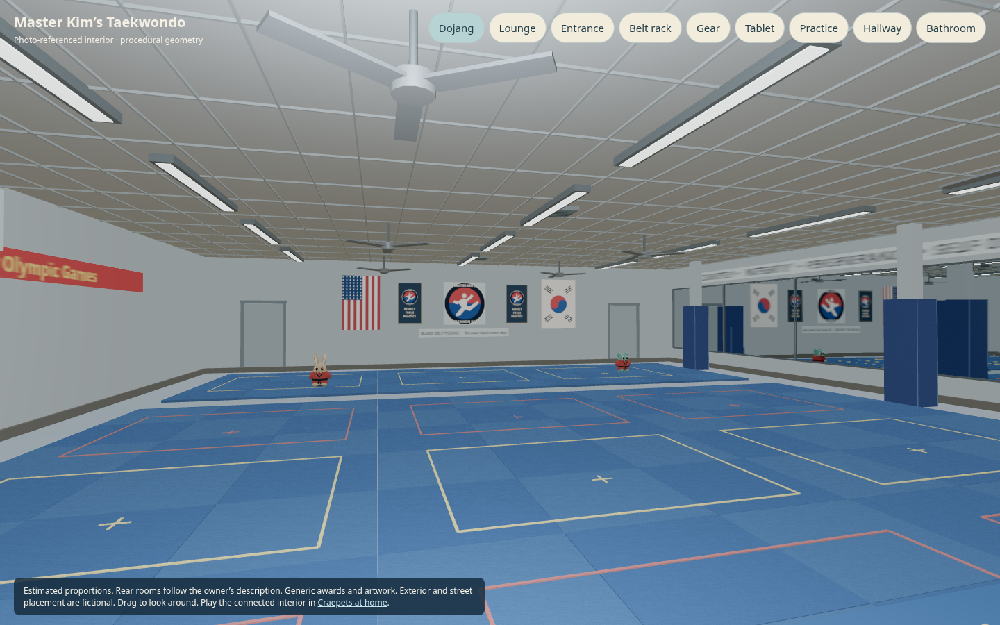
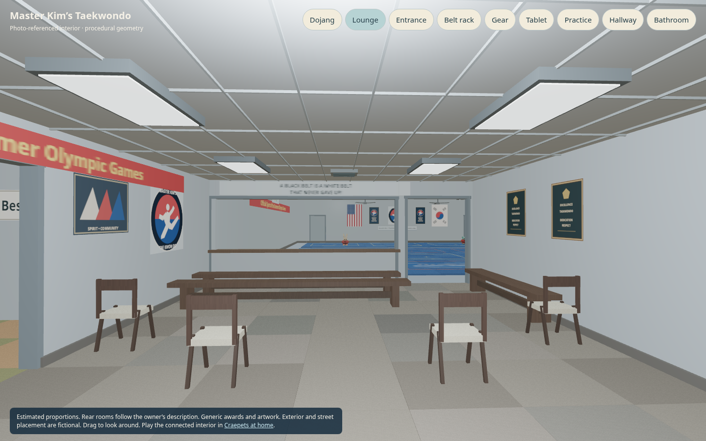
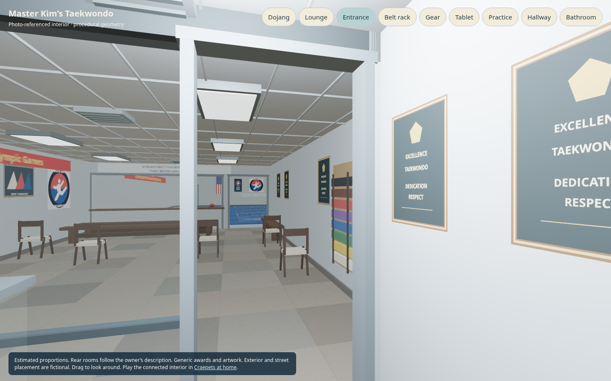
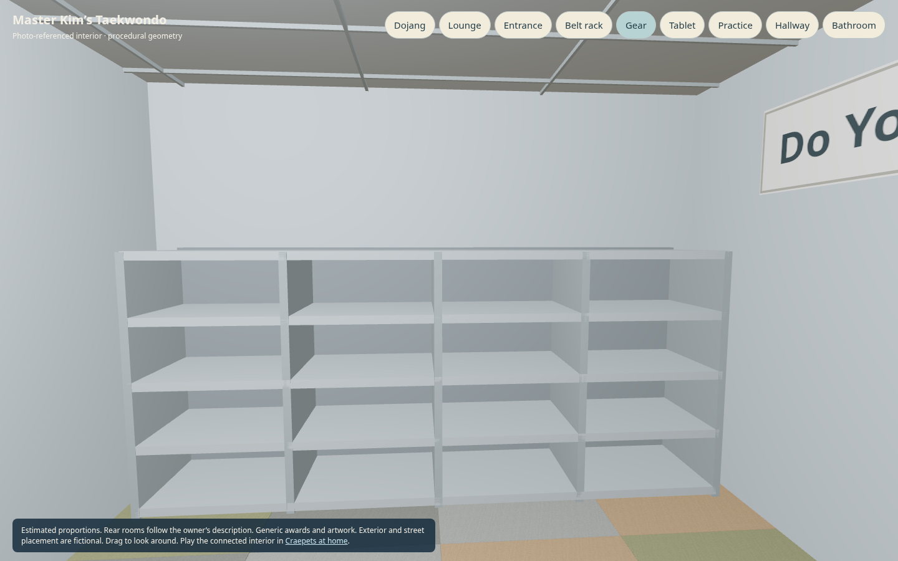
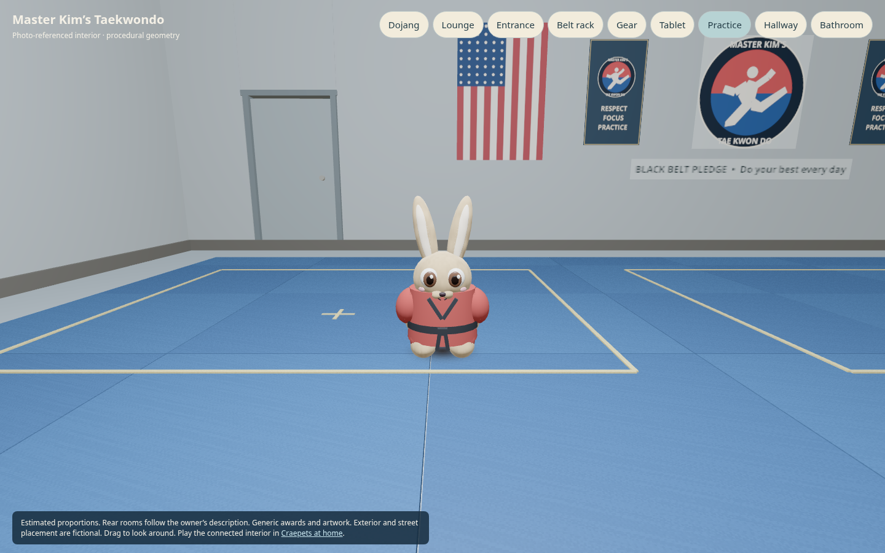
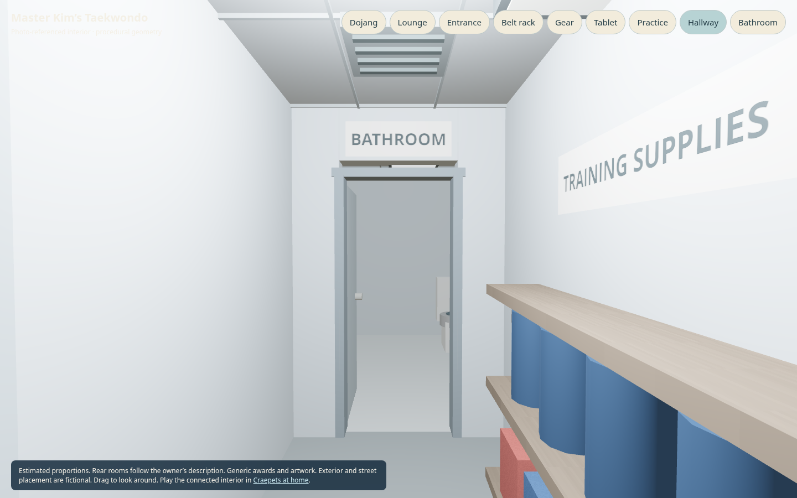

# Master Kim's Taekwondo

A procedural, photo-referenced interior for **Craepets at home** (`house-test/`).
Enter from the east end of Craepet Street, or open **Rooms → Master Kim's**.
The existing arrow keys, touch pad, swipe camera, room directions and map apply.
Walk through the vestibule and spectator lounge, then through the door beside the
observation window onto the dojang floor. Both entry doors remain open. The narrow vestibule has a sign-in iPad: approach it and press **E** or tap the activity button (or the tablet). Sign in for practice, choose a white dobok and belt colour, then meet the two red-uniformed, black-belt instructor Craepets on the mats. The practice choice is saved per profile in this browser; usual outfits return when leaving the school. It does not record real attendance or award real ranks. Just past the inner entry, turn right for the
shoe and gear room; its belt rack stands beside the doorway. Uniform choices are also available there. Lobby chairs face the mat room.

The two far-side mat-room doors open into short supply hallways leading to bathrooms. Approach a door and press **E**, tap its activity button, or tap the door itself; it can be closed from either side. Moving doors pause when a pet is in the way. The original house’s garage door also opens and closes with **E** or the activity button at the opening, and pauses for pets or cars in its path.

From the original house, **Rooms → Master Kim's dojang** travels there in the
same game. The paw button beside the room draws a continuous walking route from
the house through Craepet Street. Return through the street or choose
**Rooms → Living room**. Saved pets, family, inventory and decorating stay with
the existing house; reloading at the school keeps the saved location.

[Interactive model preview](preview.html) · [Blender model](master-kim.blend) ·
[Portable GLB](master-kim.glb)








[Sign-in tablet](previews/tablet.png) · [Bathroom](previews/bathroom.png)

Actual game captures: [desktop](previews/game-desktop.png) ·
[phone](previews/game-mobile.png), plus the corrected [entrance](previews/game-entrance.png)
and [gear room on mobile](previews/game-gear-mobile.png), [sign-in and uniforms](previews/game-signin-mobile.png),
[instructor practice](previews/game-practice.png), and the garage [closed](previews/game-garage-closed.png)
or [open](previews/game-garage-open.png). All previews are procedural renders.

The model follows seven private interior photographs: the glazed display entrance,
patchwork carpet, pale blue-gray walls, dark folding chairs and benches, belt rack,
awards, Olympic banner, observation window, blue mats and taped practice squares,
gray lanes, right-hand mirror wall with blue padded posts, ceiling grid, strip
lights, fans and US/Korean flags. The logo is a code-drawn approximation; awards
and wall art are generic. People, portraits, personal belongings and photo pixels
are excluded. The signs encourage respect, focus, practice and counting steps.

Dimensions are **proportional estimates**, not measurements. The lounge is about
7 × 11 m plus a narrower 3.1 × 3 m vestibule; the dojang is about 16 × 18 m. The rear supply corridors and bathrooms follow the owner’s description; their dimensions and unseen finishes are estimates. The plain outer shell, street placement and connecting path
are fictional. This is not a survey, architectural record or exact brand artwork.

## Sources and outputs

- `house-test/master-kim-layout.mjs`: shared shape, collider, room and light definitions.
- `house-test/master-kim.mjs`: batched Three.js geometry, surface grain, signage and mirror.
- `house-test/master-kim/signs.png`: generated atlas, no photographic content.
- `house-test/studio-interactions.mjs` and `taekwondo-uniform.mjs`: game instructors, local sign-in and skinned practice outfits. These creatures use the game rig; they are separate from the building GLB.
- `house-test/moving-doors.mjs` and `garage-door.mjs`: moving collision/camera bounds and the original house’s garage panels.
- `draw_signs.py`: reproducible Pillow drawing source (Open Sans font; override `FONT`/`REG` for another local font).
- `export-model.mjs` + `build.py`: export the same model as editable Blender and portable GLB.
- `house-test/vendor/Reflector.mjs`: Three.js r180's MIT-licensed Reflector, from
  <https://github.com/mrdoob/three.js/blob/r180/examples/jsm/objects/Reflector.js>.
  Only its import path changes. License: `house-test/vendor/THREE-LICENSE.txt`.

The browser requires no Blender, npm install, build step, network service or CDN.
The mirror is 768² on desktop and 384² on touch devices, without MSAA. It updates
only for a player camera near the school, never for nested reflection probes.
The school adds 906 primitive parts, merged by finish, and 138 source colliders. Four door leaves have separate moving geometry and colliders.
A separate triangle guard keeps the camera clear of the static drawn geometry; moving doors update conservative camera bounds with their walking collision. Paw directions refresh after door movement.
Existing practical lights supply the nearby ceiling light. Direct sun is reduced
in the school's materials because its opaque roof lies outside the house's sun
shadow atlas; this is an explicit game-lighting approximation, not a GI bake.

## Rebuild standalone models

From the repository root, using existing Node, Pillow and Blender:

```sh
python3 models/master-kim/draw_signs.py
node models/master-kim/export-model.mjs /tmp/master-kim.json
blender -b --python models/master-kim/build.py -- /tmp/master-kim.json /tmp/master-kim
```

This writes `master-kim.blend` and `master-kim.glb` to the selected output folder.
The JSON uses Three.js metres / Y up; Blender uses local metres / Z up; GLB exports
standard Y up. Blender packs only the procedural atlas. No private reference is
an input to either script. The existing house model and lighting exports are not
rebuilt or changed. The browser moves its five existing garage panels using their original vertex ranges. School door pivots are editable in Blender, with open/close keyframes at frames 1–90 and exported GLB animations.

## Review and verification

```sh
python3 -m http.server 8765 --bind 127.0.0.1
node tests/house-master-kim.mjs
node tests/house-studio-life.mjs
CHROMIUM_PATH=/usr/bin/chromium node tests/house-studio-routing.cjs
CHROMIUM_PATH=/usr/bin/chromium node tests/house-studio-life.cjs
node tests/house-routes.mjs
node tests/house-camera-clearance.mjs
node tests/house-map.mjs
CHROMIUM_PATH=/usr/bin/chromium KIM_CAPTURE_DIR=/tmp/master-kim-qa node tests/house-master-kim.cjs
CHROMIUM_PATH=/usr/bin/chromium node tests/house-master-kim-trip.cjs
CHROMIUM_PATH=/usr/bin/chromium node tests/house-craepets.cjs
```

The new browser test uses real keyboard and touch input for entry/re-entry,
observation-window collision and the padded posts, and checks room travel, the
school map, mobile layout and console errors. Capture paths stay outside source
by default. Reference photos must never be copied into this public repository.

The trip test starts in the original house and checks both directions of paw-print
guidance, Rooms travel, native desktop/mobile movement, saved location on reload,
and preservation of family, coins, inventory and decorating. It walks from the
entrance through the right-hand gear doorway and back with keyboard/touch input,
checks the map and gear reload, and recovers positions saved in the former gear
room, or outside the narrowed vestibule. That position-only migration leaves other saves untouched. The geometry test
traverses the complete house-to-school and return paths against the game's actual
collision world, including house glazing.

On a CPU-only browser, `HOUSE_QUERY='?pr=0.25'` pins the existing game QA
render scale for control tests. `HOUSE_TIMEOUT=180000` gives the broad
Craepets test more time for software shader compilation. These options change
neither controls nor assertions. Full-resolution captures should be reviewed
separately. `preview.html` is a lightweight interactive model review with camera
buttons; it renders the same school geometry without loading the entire house.

Integration also repairs the existing lighting `prime()` timer: forcing initial
selection with infinity had prevented later practical-light selections. The
renderer regression now proves that lights clear when leaving a room and return
when reentering.
